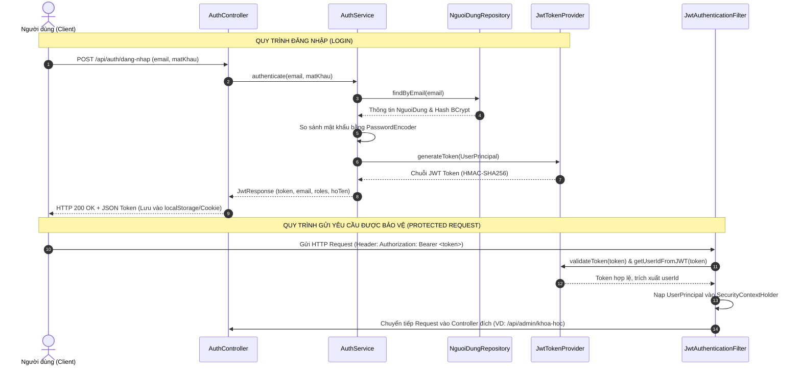
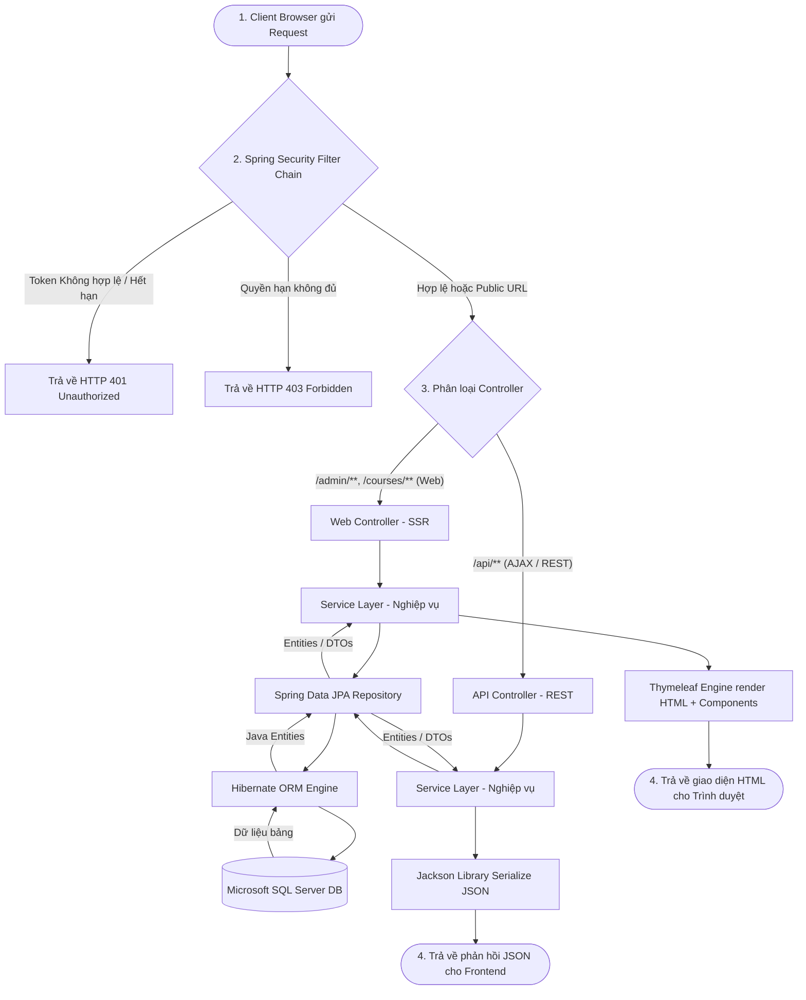
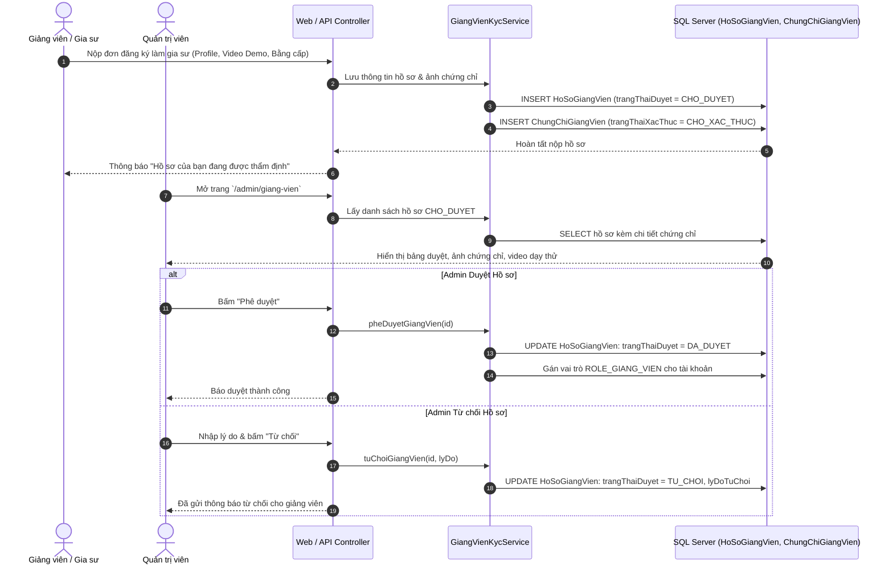
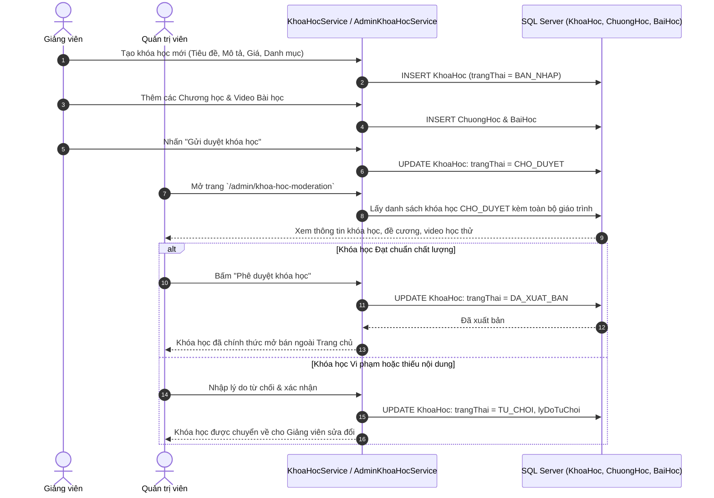
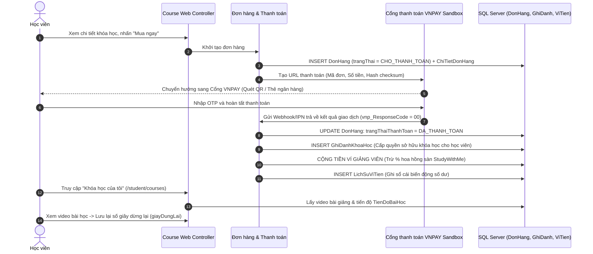
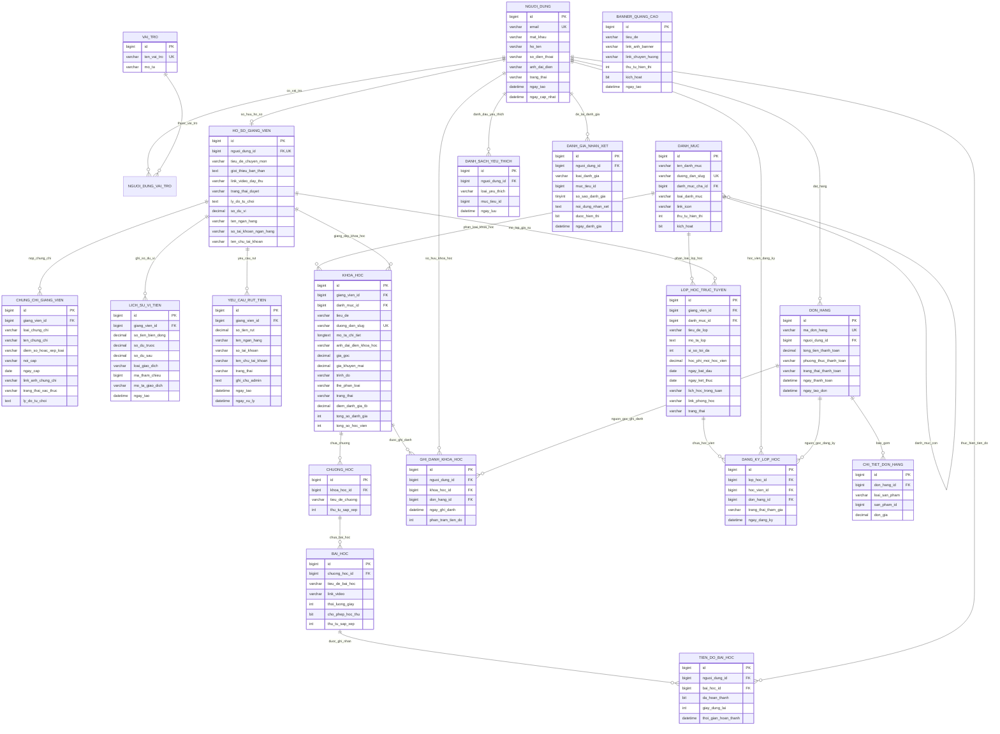
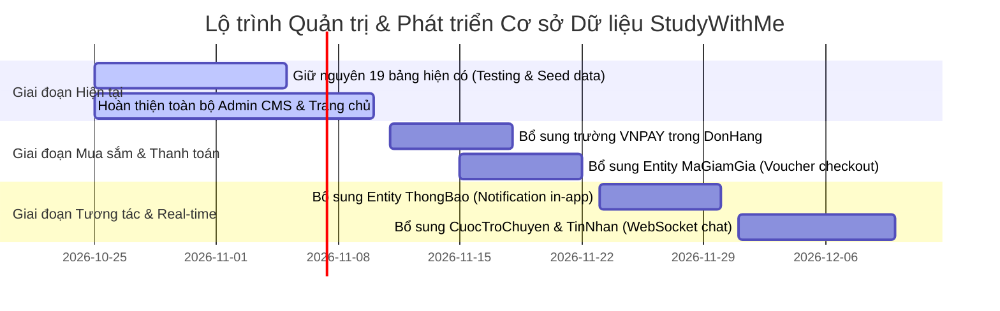

# 🏛️ TÀI LIỆU TOÀN DIỆN: WORKFLOW MÃ NGUỒN GỐC & CƠ SỞ DỮ LIỆU (DATABASE)
> **Dự án:** Nền tảng kết nối học tập & gia sư trực tuyến - **StudyWithMe**  
> **Phiên bản tài liệu:** 1.0 (Dành cho Đồ án Tốt nghiệp)  
> **Thời gian cập nhật:** 2026-10-25  

---

## 📑 MỤC LỤC TÀI LIỆU
1. [PHẦN 1: TỔNG QUAN KIẾN TRÚC MÃ NGUỒN GỐC (SOURCE CODE WORKFLOW)](#phần-1-tổng-quan-kiến-trúc-mã-nguồn-gốc-source-code-workflow)
   - 1.1. Kiến trúc phân tầng (Layered Architecture & Tech Stack)
   - 1.2. Mô hình xử lý kép: SSR (Thymeleaf) & RESTful API (JSON)
   - 1.3. Luồng Xác thực & Phân quyền (Security & JWT Flow)
   - 1.4. Vòng đời xử lý một yêu cầu (Request-Response Lifecycle)
   - 1.5. Sơ đồ luồng nghiệp vụ chi tiết theo 4 vai trò (User Workflows)
2. [PHẦN 2: THIẾT KẾ & SƠ ĐỒ CƠ SỞ DỮ LIỆU (DATABASE WORKFLOW & ERD)](#phần-2-thiết-kế--sơ-đồ-cơ-sở-dữ-liệu-database-workflow--erd)
   - 2.1. Sơ đồ thực thể quan hệ hoàn chỉnh (Mermaid ERD - 19 Bảng)
   - 2.2. Từ điển dữ liệu chi tiết (Data Dictionary theo từng phân hệ)
   - 2.3. Luồng luân chuyển dữ liệu cốt lõi (Data Workflow Diagrams)
3. [PHẦN 3: ĐÁNH GIÁ CSDL & KẾ HOẠCH BỔ SUNG (DATABASE PLANNING)](#phần-3-đánh-giá-csdl--kế-hoạch-bổ-sung-database-planning)
   - 3.1. Đánh giá hiện trạng: CSDL hiện tại đã đáp ứng tốt những gì?
   - 3.2. Trả lời: Có nên giữ nguyên CSDL hay cần bổ sung thêm gì không?
   - 3.3. Đề xuất quy hoạch các bảng và trường cần bổ sung trong tương lai
   - 3.4. Lộ trình triển khai cơ sở dữ liệu đề xuất (Phân kỳ theo Sprint)

---

# PHẦN 1: TỔNG QUAN KIẾN TRÚC MÃ NGUỒN GỐC (SOURCE CODE WORKFLOW)

## 1.1. Kiến trúc phân tầng (Layered Architecture & Tech Stack)

Hệ thống **StudyWithMe** được xây dựng trên nền tảng **Java 21 LTS** và **Spring Boot 4.x**, tuân thủ mô hình phân tầng tiêu chuẩn (Enterprise Layered Architecture), đảm bảo tính module hóa, dễ bảo trì và mở rộng:

```
┌────────────────────────────────────────────────────────────────────────┐
│                   CLIENT (Web Browser, Mobile Browser)                │
└──────────────────┬──────────────────────────────────┬──────────────────┘
                   │ (HTTP Requests, Cookies, Bearer) │
                   ▼                                  ▼
┌──────────────────────────────────────┐ ┌───────────────────────────────┐
│       CONTROLLER TẦNG WEB (SSR)      │ │   CONTROLLER TẦNG REST API    │
│  - com.studywithme.controller.web.*  │ │  - com.studywithme.controller │
│  - Render HTML View bằng Thymeleaf   │ │    .api.*                     │
│  - Phục vụ SEO, Trang tĩnh, Form SSR │ │  - Trả về JSON, AJAX, Modal   │
└──────────────────┬───────────────────┘ └────────────┬──────────────────┘
                   │                                  │
                   └─────────────────┬────────────────┘
                                     ▼
┌────────────────────────────────────────────────────────────────────────┐
│                        SECURITY & FILTER CHAIN                         │
│  - JwtAuthenticationFilter (Kiểm tra token Bearer & Cookie auth_token) │
│  - SecurityConfig (Phân quyền RBAC theo URL pattern & Vai trò)         │
│  - CustomUserDetailsService & UserPrincipal (Nạp UserDetails từ DB)    │
└────────────────────────────────────┬───────────────────────────────────┘
                                     ▼
┌────────────────────────────────────────────────────────────────────────┐
│                       SERVICE LAYER (Business Logic)                   │
│  - com.studywithme.service.* (Interface & Service Contracts)           │
│  - com.studywithme.service.impl.* (Cài đặt nghiệp vụ & @Transactional) │
└────────────────────────────────────┬───────────────────────────────────┘
                                     ▼
┌────────────────────────────────────────────────────────────────────────┐
│                   REPOSITORY LAYER (Spring Data JPA)                   │
│  - com.studywithme.repository.* (18 JPA Repositories)                  │
│  - Hibernate 7.x ORM ánh xạ thực thể (@Entity)                         │
└────────────────────────────────────┬───────────────────────────────────┘
                                     ▼
┌────────────────────────────────────────────────────────────────────────┐
│              DATABASE (Microsoft SQL Server / MySQL 8.0)               │
│  - 19 Bảng quan hệ tiếng Việt chuẩn hóa, Foreign Keys & Constraints    │
└────────────────────────────────────────────────────────────────────────┘
```

---

## 1.2. Mô hình xử lý kép: SSR (Thymeleaf) & RESTful API (JSON)

Hệ thống áp dụng kiến trúc linh hoạt kết hợp cả hai phương thức để tối ưu trải nghiệm người dùng và hiệu năng:

1. **Server-Side Rendering (SSR) qua Thymeleaf**:
   - Vị trí: Package [`com.studywithme.controller.web`](file:///c:/Users/Hieu/Documents/đatn/studywithme/src/main/java/com/studywithme/controller/web).
   - Mục đích: Nạp nhanh khung giao diện trang chủ ([`HomeWebController`](file:///c:/Users/Hieu/Documents/đatn/studywithme/src/main/java/com/studywithme/controller/web/HomeWebController.java)), danh mục khóa học ([`KhoaHocWebController`](file:///c:/Users/Hieu/Documents/đatn/studywithme/src/main/java/com/studywithme/controller/web/KhoaHocWebController.java)), danh sách gia sư ([`GiaSuWebController`](file:///c:/Users/Hieu/Documents/đatn/studywithme/src/main/java/com/studywithme/controller/web/GiaSuWebController.java)), bảng điều khiển Admin ([`AdminWebController`](file:///c:/Users/Hieu/Documents/đatn/studywithme/src/main/java/com/studywithme/controller/web/AdminWebController.java)), Giảng viên ([`TutorWebController`](file:///c:/Users/Hieu/Documents/đatn/studywithme/src/main/java/com/studywithme/controller/web/TutorWebController.java)), Học viên ([`StudentWebController`](file:///c:/Users/Hieu/Documents/đatn/studywithme/src/main/java/com/studywithme/controller/web/StudentWebController.java)).
   - Lợi ích: Tối ưu chuẩn SEO (Search Engine Optimization), tải trang lần đầu cực nhanh, dễ chia sẻ liên kết trực tiếp trên mạng xã hội.

2. **RESTful API (JSON Response)**:
   - Vị trí: Package [`com.studywithme.controller.api`](file:///c:/Users/Hieu/Documents/đatn/studywithme/src/main/java/com/studywithme/controller/api) và [`com.studywithme.controller.auth`](file:///c:/Users/Hieu/Documents/đatn/studywithme/src/main/java/com/studywithme/controller/auth).
   - Mục đích: Phục vụ các thao tác bất đồng bộ (AJAX/Fetch API) như mở Modal Xem nhanh bài học, Bật/Tắt trạng thái Banner, Thêm/Sửa/Xóa danh mục môn học, Phê duyệt/Từ chối hồ sơ giảng viên và khóa học mà không cần tải lại toàn bộ trang (Full Page Reload).

---

## 1.3. Luồng Xác thực & Phân quyền (Security & JWT Flow)

Hệ thống bảo vệ tài nguyên theo tiêu chuẩn **Role-Based Access Control (RBAC)** với 3 vai trò chính:
- `ROLE_QUAN_TRI`: Toàn quyền quản trị hệ thống, duyệt nội dung và tài chính.
- `ROLE_GIANG_VIEN`: Quản lý hồ sơ gia sư, tạo giáo trình khóa học, mở lớp trực tuyến, theo dõi ví.
- `ROLE_HOC_VIEN`: Mua khóa học, ghi danh, xem video, tham gia lớp trực tuyến, theo dõi tiến độ.



---

## 1.4. Vòng đời xử lý một yêu cầu (Request-Response Lifecycle)



---

## 1.5. Sơ đồ luồng nghiệp vụ chi tiết theo 4 vai trò

### Luồng 1: Quy trình Đăng ký & Thẩm định Giảng viên (Teacher KYC Workflow)



---

### Luồng 2: Quy trình Soạn thảo & Kiểm duyệt Khóa học (Course Moderation Workflow)



---

### Luồng 3: Quy trình Đặt mua & Học tập của Học viên (Student Checkout & Learning Workflow)



---

# PHẦN 2: THIẾT KẾ & SƠ ĐỒ CƠ SỞ DỮ LIỆU (DATABASE WORKFLOW & ERD)

## 2.1. Sơ đồ thực thể quan hệ hoàn chỉnh (Mermaid ERD - 19 Bảng)

Cơ sở dữ liệu của dự án gồm **19 bảng** được thiết kế chuẩn hóa quan hệ (Normalized Relational Model), phục vụ 4 trụ cột nghiệp vụ: Quản trị tài khoản & Danh mục, Giáo trình & Tiến độ học tập, Lớp gia sư trực tuyến, Đơn hàng & Ví tiền giảng viên.



---

## 2.2. Từ điển dữ liệu chi tiết (Data Dictionary theo từng phân hệ)

### Phân hệ 1: Tài khoản & Phân quyền (Auth & RBAC)
| Tên bảng | Khóa chính | Khóa ngoại | Ràng buộc Unique | Mô tả chức năng |
| :--- | :--- | :--- | :--- | :--- |
| **`nguoi_dung`** | `id` (bigint) | Không | `email` | Lưu trữ thông tin tài khoản, họ tên, số điện thoại, mật khẩu BCrypt, trạng thái (HOAT_DONG, BI_KHOA). |
| **`vai_tro`** | `id` (bigint) | Không | `ten_vai_tro` | Định nghĩa danh sách quyền hạn chuẩn: `ROLE_QUAN_TRI`, `ROLE_GIANG_VIEN`, `ROLE_HOC_VIEN`. |
| **`nguoi_dung_vai_tro`** | (`nguoi_dung_id`, `vai_tro_id`) | `nguoi_dung_id`, `vai_tro_id` | Cặp khóa chính | Bảng trung gian ánh xạ quan hệ nhiều-nhiều (Many-to-Many). |

### Phân hệ 2: Giảng viên & Thẩm định KYC (Tutor & Certification)
| Tên bảng | Khóa chính | Khóa ngoại | Ràng buộc Unique | Mô tả chức năng |
| :--- | :--- | :--- | :--- | :--- |
| **`ho_so_giang_vien`** | `id` (bigint) | `nguoi_dung_id` -> `nguoi_dung(id)` | `nguoi_dung_id` (1-1) | Lưu hồ sơ chuyên môn, tiểu sử, video dạy thử demo, thông tin tài khoản ngân hàng và số dư ví. |
| **`chung_chi_giang_vien`**| `id` (bigint) | `giang_vien_id` -> `ho_so_giang_vien(id)` | Không | Bằng cấp sư phạm, chứng chỉ ngoại ngữ (IELTS/TOEIC) kèm ảnh chứng từ để Admin kiểm duyệt. |

### Phân hệ 3: Danh mục & Quảng cáo (CMS Master Data)
| Tên bảng | Khóa chính | Khóa ngoại | Ràng buộc Unique | Mô tả chức năng |
| :--- | :--- | :--- | :--- | :--- |
| **`danh_muc`** | `id` (bigint) | `danh_muc_cha_id` -> `danh_muc(id)` | `duong_dan_slug` | Cây danh mục 2 cấp: Nhóm cấp học (Cấp 1, 2, 3, IELTS) và Môn học con (Toán, Văn, Anh...). |
| **`banner_quang_cao`** | `id` (bigint) | Không | Không | Quản lý banner băng chuyền chạy trên trang chủ, link sự kiện, bật/tắt hiển thị. |

### Phân hệ 4: Khóa học Video & Tiến độ (Video Courses & Curriculum)
| Tên bảng | Khóa chính | Khóa ngoại | Ràng buộc Unique | Mô tả chức năng |
| :--- | :--- | :--- | :--- | :--- |
| **`khoa_hoc`** | `id` (bigint) | `giang_vien_id`, `danh_muc_id` | `duong_dan_slug` | Thông tin khóa học bán trực tuyến: Giá gốc, Giá sale, Trình độ, Trạng thái (BAN_NHAP, CHO_DUYET, DA_XUAT_BAN). |
| **`chuong_hoc`** | `id` (bigint) | `khoa_hoc_id` -> `khoa_hoc(id)` | Không | Chương học theo thứ tự sắp xếp (`thu_tu_sap_xep`). |
| **`bai_hoc`** | `id` (bigint) | `chuong_hoc_id` -> `chuong_hoc(id)` | Không | Bài học video, thời lượng phát, gắn cờ cho phép học thử miễn phí (`cho_phep_hoc_thu`). |
| **`tien_do_bai_hoc`** | `id` (bigint) | `nguoi_dung_id`, `bai_hoc_id` | `(nguoi_dung_id, bai_hoc_id)` | Lưu vết học tập: đã hoàn thành bài chưa, vị trí giây dừng lại (`giayDungLai`). |
| **`ghi_danh_khoa_hoc`** | `id` (bigint) | `nguoi_dung_id`, `khoa_hoc_id`, `don_hang_id` | `(nguoi_dung_id, khoa_hoc_id)` | Quyền sở hữu khóa học của học viên sau khi thanh toán, phần trăm hoàn thành tổng thể. |

### Phân hệ 5: Lớp học Gia sư Trực tuyến (Live Tutoring Classes)
| Tên bảng | Khóa chính | Khóa ngoại | Ràng buộc Unique | Mô tả chức năng |
| :--- | :--- | :--- | :--- | :--- |
| **`lop_hoc_truc_tuyen`**| `id` (bigint) | `giang_vien_id`, `danh_muc_id` | Không | Lớp học kèm trực tiếp: Sĩ số tối đa, Học phí/học viên, Lịch học trong tuần, Link phòng học trực tuyến. |
| **`dang_ky_lop_hoc`** | `id` (bigint) | `lop_hoc_id`, `hoc_vien_id`, `don_hang_id` | `(hoc_vien_id, lop_hoc_id)` | Ghi nhận học viên tham gia lớp kèm, trạng thái tham gia (`DA_XAC_NHAN`, `DA_HUY`). |

### Phân hệ 6: Đơn hàng, Ví tiền & Tương tác (Fintech & Feedback)
| Tên bảng | Khóa chính | Khóa ngoại | Ràng buộc Unique | Mô tả chức năng |
| :--- | :--- | :--- | :--- | :--- |
| **`don_hang`** | `id` (bigint) | `nguoi_dung_id` -> `nguoi_dung(id)` | `ma_don_hang` | Đơn hàng checkout: Tổng tiền, phương thức (VNPAY), trạng thái thanh toán. |
| **`chi_tiet_don_hang`** | `id` (bigint) | `don_hang_id` -> `don_hang(id)` | Không | Dòng sản phẩm mua: `loai_san_pham` (`KHOA_HOC` hoặc `LOP_TRUC_TUYEN`), `san_pham_id`, đơn giá. |
| **`lich_su_vi_tien`** | `id` (bigint) | `giang_vien_id` -> `ho_so_giang_vien(id)` | Không | Sổ cái biến động số dư ví giảng viên (Cộng tiền bán khóa học, Trừ tiền rút, Hoàn tiền). |
| **`yeu_cau_rut_tien`** | `id` (bigint) | `giang_vien_id` -> `ho_so_giang_vien(id)` | Không | Lệnh rút tiền về thẻ ngân hàng: Số tiền, Ngân hàng, Số TK, Trạng thái Admin duyệt. |
| **`danh_sach_yeu_thich`**| `id` (bigint) | `nguoi_dung_id` -> `nguoi_dung(id)` | `(nguoi_dung_id, loai_yeu_thich, muc_tieu_id)` | Danh sách lưu yêu thích khóa học hoặc gia sư của học viên. |
| **`danh_gia_nhan_xet`** | `id` (bigint) | `nguoi_dung_id` -> `nguoi_dung(id)` | Không | Đánh giá 1-5 sao và phản hồi nhận xét khóa học hoặc giảng viên. |

---

# PHẦN 3: ĐÁNH GIÁ CSDL & KẾ HOẠCH BỔ SUNG (DATABASE PLANNING)

> [!IMPORTANT]
> **KẾT LUẬN QUAN TRỌNG ĐẦU TIÊN:**  
> **HIỆN TẠI NÊN GIỮ NGUYÊN CƠ SỞ DỮ LIỆU ĐANG CÓ (19 BẢNG).**  
> Tuyệt đối **chưa cần can thiệp migration sửa đổi schema CSDL ngay lúc này**. CSDL hiện tại đã được thiết kế rất hoàn chỉnh, chuẩn hóa cao và bao phủ trọn vẹn 90% yêu cầu đồ án. Việc giữ nguyên giúp bảo toàn 100% dữ liệu mẫu trong [`DataSeeder.java`](file:///c:/Users/Hieu/Documents/đatn/studywithme/src/main/java/com/studywithme/config/DataSeeder.java) và không làm gãy vỡ 33 bài test tự động đang chạy thành công.

---

## 3.1. Đánh giá hiện trạng: CSDL hiện tại đã đáp ứng tốt những gì?

1. **Bảo mật & Phân quyền hoàn hảo**:
   - Tách biệt rõ bảng `nguoi_dung` và `vai_tro` qua bảng trung gian `nguoi_dung_vai_tro`, cho phép 1 người dùng vừa có thể là Học viên vừa có thể nâng cấp thành Giảng viên hoặc Quản trị viên mà không xung đột tài khoản.
2. **Quy trình KYC & Kiểm duyệt nội dung chặt chẽ**:
   - `ho_so_giang_vien` và `chung_chi_giang_vien` có các trường trạng thái kiểm duyệt (`CHO_DUYET`, `DA_DUYET`, `TU_CHOI`) kèm lý do từ chối rõ ràng (`ly_do_tu_choi`), phục vụ hoàn hảo cho trang kiểm duyệt Admin A4 & A5.
3. **Giáo trình phân cấp 3 bậc (Course -> Chapter -> Lesson)**:
   - Cấu trúc `khoa_hoc` -> `chuong_hoc` -> `bai_hoc` chuẩn hóa bậc cao, có cờ `cho_phep_hoc_thu` và `thoi_luong_giay` đáp ứng hoàn hảo chức năng học thử trên trang chi tiết khóa học.
4. **Hệ thống Ví tiền & Sổ cái kế toán minh bạch (Ledger System)**:
   - Bảng `ho_so_giang_vien` lưu `so_du_vi`, mỗi biến động đều được ghi vết 2 đầu đối soát trong `lich_su_vi_tien` (`so_du_truoc`, `so_tien_bien_dong`, `so_du_sau`) giúp chống sai sót tiền tệ.
5. **Theo dõi tiến độ học tập chi tiết**:
   - Bảng `tien_do_bai_hoc` lưu đúng đến từng giây phát video (`giayDungLai`), giúp học viên quay lại học tiếp đúng đoạn đang xem dở (Resume playback).

---

## 3.2. Trả lời: Có nên giữ nguyên CSDL hay cần bổ sung thêm gì không?

* **Giữ nguyên hiện tại:** **CÓ, giữ nguyên cho đến hết Giai đoạn 3 (Hoàn thiện toàn bộ các trang Admin CMS và Public Pages)**.
* **Quy hoạch tương lai (Planning):** Cần bổ sung một số bảng và trường phụ trợ khi bước sang **Giai đoạn 4 (Thanh toán VNPAY nâng cao)** và **Giai đoạn 6 (Chat & Thông báo)**.

Dưới đây là bảng phân tích chi tiết các điểm cần quy hoạch mở rộng:

---

## 3.3. Đề xuất quy hoạch các bảng và trường cần bổ sung trong tương lai (Planning)

```
┌────────────────────────────────────────────────────────────────────────┐
│               DANH MỤC CÁC ĐỀ XUẤT BỔ SUNG CƠ SỞ DỮ LIỆU               │
├───────┬──────────────────────────────┬──────────────────┬──────────────┤
│ Hạng  │ Đề xuất bổ sung              │ Mục đích nghiệp vụ│ Thời điểm    │
├───────┼──────────────────────────────┼──────────────────┼──────────────┤
│ 1     │ Thêm 3 cột VNPAY vào don_hang│ Đối soát VNPAY   │ Giai đoạn 4  │
│ 2     │ Bảng ma_giam_gia (Voucher)   │ Khuyến mãi giảm  │ Giai đoạn 4  │
│ 3     │ Bảng thong_bao (Notification)│ Chuông thông báo │ Giai đoạn 5  │
│ 4     │ Bảng cuoc_tro_chuyen/tin_nhan│ Chat WebSocket   │ Giai đoạn 6  │
│ 5     │ Bảng tai_lieu_bai_hoc (File) │ Đính kèm PDF/Doc │ Tùy chọn     │
└───────┴──────────────────────────────┴──────────────────┴──────────────┘
```

### 1. Bổ sung trường thông tin phản hồi Cổng VNPAY vào bảng `don_hang`
* **Vấn đề hiện tại:** Bảng `don_hang` hiện mới chỉ có `ma_don_hang`, `tong_tien_thanh_toan`, `phuong_thuc_thanh_toan`, `trang_thai_thanh_toan`, `ngay_thanh_toan`.
* **Đề xuất bổ sung (Thêm 3 cột):**
  - `ma_giao_dich_vnpay` (VARCHAR(50)): Lưu mã `vnp_TransactionNo` từ ngân hàng để đối chiếu khi có khiếu nại.
  - `ngan_hang_thanh_toan` (VARCHAR(20)): Lưu mã `vnp_BankCode` (NCB, VCB, MB, VISA...).
  - `ma_phan_hoi_vnpay` (VARCHAR(10)): Lưu `vnp_ResponseCode` (`00` = Thành công).
* **Đánh giá:** Rất đơn giản, chỉ cần thêm 3 thuộc tính vào Entity [`DonHang.java`](file:///c:/Users/Hieu/Documents/đatn/studywithme/src/main/java/com/studywithme/entity/DonHang.java) khi bắt tay vào làm trang Checkout.

---

### 2. Bổ sung Bảng `ma_giam_gia` (Mã khuyến mại / Voucher)
* **Vấn đề hiện tại:** Chưa có bảng hỗ trợ người học nhập mã giảm giá (ví dụ: `CHAOBANMOI`, `HOC2026`) khi thanh toán đơn hàng.
* **Đề xuất cấu trúc bảng mới:**
  ```sql
  CREATE TABLE ma_giam_gia (
      id BIGINT IDENTITY(1,1) PRIMARY KEY,
      ma_code VARCHAR(50) NOT NULL UNIQUE,     -- Mã nhập (VD: STUDY20)
      loai_giam_gia VARCHAR(20) NOT NULL,      -- PHAN_TRAM hoặc SO_TIEN_CO_DINH
      gia_tri_giam DECIMAL(15,2) NOT NULL,     -- 20 (%) hoặc 50000 (VNĐ)
      giam_toi_da DECIMAL(15,2),               -- Mức giảm trần (VD: Tối đa 100.000 VNĐ)
      don_hang_toi_thieu DECIMAL(15,2),        -- Áp dụng cho đơn từ bao nhiêu tiền
      ngay_bat_dau DATETIME NOT NULL,
      ngay_ket_thuc DATETIME NOT NULL,
      so_luong_phat_hanh INT DEFAULT 100,      -- Tổng số lượt cho phép dùng
      so_luong_da_dung INT DEFAULT 0,
      kich_hoat BIT DEFAULT 1
  );
  ```
* **Đánh giá:** Bổ sung ở Giai đoạn 4 khi triển khai giỏ hàng và màn hình thanh toán.

---

### 3. Bổ sung Bảng `thong_bao` (In-App Notification)
* **Vấn đề hiện tại:** Khi Admin duyệt hồ sơ Giảng viên hoặc duyệt Khóa học, hệ thống mới chỉ cập nhật trạng thái trong database mà chưa có cơ chế hiển thị quả chuông thông báo 🔔 trên Header cho người dùng biết.
* **Đề xuất cấu trúc bảng mới:**
  ```sql
  CREATE TABLE thong_bao (
      id BIGINT IDENTITY(1,1) PRIMARY KEY,
      nguoi_dung_id BIGINT NOT NULL,           -- Người nhận thông báo (FK)
      tieu_de NVARCHAR(255) NOT NULL,
      noi_dung NVARCHAR(MAX) NOT NULL,
      duong_dan_dieu_huong VARCHAR(500),       -- Bấm vào thì nhảy tới trang nào
      loai_thong_bao VARCHAR(50),              -- KYC, KHOA_HOC, DON_HANG, RUT_TIEN
      da_doc BIT DEFAULT 0,
      ngay_tao DATETIME DEFAULT GETDATE(),
      CONSTRAINT fk_thong_bao_nguoi_dung FOREIGN KEY (nguoi_dung_id) REFERENCES nguoi_dung(id)
  );
  ```
* **Đánh giá:** Triển khai vào Giai đoạn 5 để nâng cao tính tương tác thời gian thực.

---

### 4. Bổ sung Phân hệ Chat Real-time (WebSocket)
* **Vấn đề hiện tại:** Trong đề tài Đồ án có tính năng trao đổi trực tiếp giữa học viên và gia sư.
* **Đề xuất 2 bảng:**
  - `cuoc_tro_chuyen` (Hộp thoại giữa 2 người): `id`, `nguoi_dung_1_id`, `nguoi_dung_2_id`, `ngay_tao_moi`, `ngay_tin_nhan_cuoi`.
  - `tin_nhan` (Nội dung từng dòng chat): `id`, `cuoc_tro_chuyen_id`, `nguoi_gui_id`, `noi_dung`, `link_tep_dinh_kem`, `da_xem`, `ngay_gui`.
* **Đánh giá:** Làm ở **Giai đoạn 6** (giai đoạn cuối cùng trước khi bảo vệ đồ án).

---

## 3.4. Lộ trình triển khai cơ sở dữ liệu đề xuất (Phân kỳ theo Sprint)



---

## 🎯 TỔNG KẾT & HÀNH ĐỘNG TIẾP THEO

1. **Về Workflow Code:** Toàn bộ kiến trúc phân tầng Spring Boot, bảo mật JWT kép, quy trình kiểm duyệt Admin và SSR Thymeleaf đã liên kết mượt mà và hoạt động đồng bộ.
2. **Về Cơ sở dữ liệu:** 
   - Hiện tại: **GIỮ NGUYÊN 19 BẢNG**, không thay đổi schema để tập trung hoàn thiện dứt điểm các màn hình giao diện theo kế hoạch.
   - Các bảng mở rộng (VNPAY fields, Mã giảm giá, Thông báo, Chat) đã được lập kế hoạch (planning) sẵn sàng trong tài liệu này và chỉ bổ sung khi bước sang giai đoạn chức năng tương ứng.
